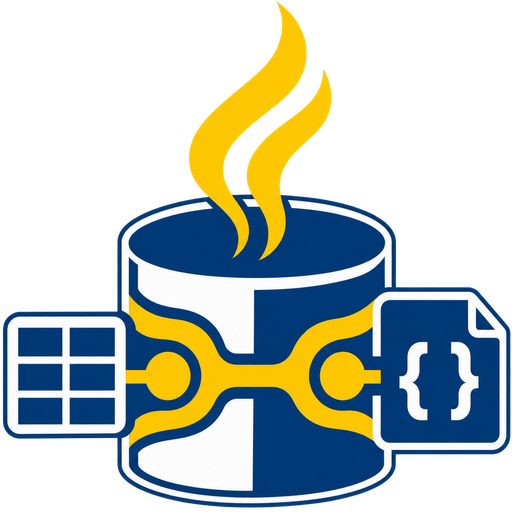

<div align="center">



**The embedded NoSQL database for the JVM — Document and Key-Value.**  
One JAR, zero infrastructure. No server, no Docker, no daemon, no network.

[](LICENSE)
[](https://openjdk.org/)
[](#build--test)
[](#why-embedjnosql)
[](#measured-artifact-sizes-this-repository-this-build)
[](demo/spring-boot-demo)
[](demo/quarkus-demo)
[](demo/micronaut-demo)
[](demo/vertx-demo)

</div>

---

## Why EmbedJNoSQL?

> **"EmbedJNoSQL is to Document and Key-Value stores what H2 is to Relational databases."**

Java developers carry a hidden tax on every project: before writing a single line of business
logic they must provision infrastructure — Docker containers, Redis daemons, MongoDB processes.
Even for a unit test. Even for a local prototype.

**EmbedJNoSQL removes that tax.** Embed a NoSQL database directly inside your JVM process. Call one
line of code. Write your business logic. Ship.

```java
// Everything you need. Nothing you don't.
try (var db = EmbedJNoSQL.inMemory()) {
    db.documentCollection("users").insert(Document.of(user.toMap()).id(user.id()));
    db.keyValueBucket("sessions").put("tok-1", "active");
    db.setBucket("permissions").sadd("admin", "write", "delete");
}
```

---

## What this product is (and is not)

EmbedJNoSQL is **NoSQL only**: Document and Key-Value are data models of one product, and
in-memory vs file-backed is a *storage mode*, not an engine choice. There is no relational
database, no SQL engine, no dual-engine selector, and no JDBC driver.

| | **EmbedJNoSQL** | H2 | MongoDB / Redis |
|---|---|---|---|
| **Primary model** | Document + Key-Value (+ wide-column, experimental vector) | Relational SQL | Single-model daemons |
| **Deployment** | Embedded, in-process | Embedded | External server |
| **Pure Java** | ✅ | ✅ | ❌ |
| **Server required** | ❌ (optional local console) | ❌ | ✅ |
| **Document queries** | ✅ Native | ⚠️ JSON functions | ✅ |
| **Redis-style structures** | ✅ Lists, sets, hashes, TTL | ❌ | ✅ (Redis) |
| **SQL** | ❌ intentionally removed | ✅ | ❌ |
| **Persistence** | In-memory, file snapshots + WAL, B-Tree, LSM tree | Page store | WiredTiger / RDB |

H2 appears here only as the reference point for *embedded simplicity*. EmbedJNoSQL's scope is
NoSQL: it does not implement SQL, and does not aim to.

---

## Architecture: Unified Multi-Model Substrate

EmbedJNoSQL executes all data models over a **single unified engine**. Collections, key-value buckets, Redis structures, and wide-column families share memory management, concurrency control (MVCC), and persistence:

```text
┌─────────────────────────────────────────────────────────────────────────┐
│                          APPLICATION CODE                               │
│   Spring Boot 4.0.0  ·  Quarkus 3.8.0  ·  Micronaut 4.2.0  ·  Vert.x  │
└────────────────────────────────────┬────────────────────────────────────┘
                                     │
┌────────────────────────────────────▼────────────────────────────────────┐
│                       EMBEDJNOSQL API SURFACE                           │
│  ┌───────────────────┬───────────────────┬───────────────────────────┐  │
│  │ Document Model    │ Key-Value & Redis │ Wide-Column & Vectors     │  │
│  │ · Dotted Queries  │ · Lists & Sets    │ · Cell TTL Matrix         │  │
│  │ · Secondary Idx   │ · Hashes & TTL    │ · HNSW Vector Search*     │  │
│  │ · Entity Mapping  │ · Atomic Counters │ · Sparse Attributes       │  │
│  └─────────┬─────────┴─────────┬─────────┴─────────────┬─────────────┘  │
│            └───────────────────┼───────────────────────┘                │
│                                │                                        │
│            ┌───────────────────▼───────────────────┐                    │
│            │   MVCC & Transaction Engine (ACID)    │                    │
│            │   Write-Ahead Log (WAL) Durability    │                    │
│            └───────────────────┬───────────────────┘                    │
└────────────────────────────────┼────────────────────────────────────────┘
                                 │
┌────────────────────────────────▼────────────────────────────────────────┐
│                        STORAGE ENGINE MODES                             │
│  ┌───────────────┬───────────────────┬─────────────────┬─────────────┐  │
│  │  IN_MEMORY    │       FILE        │     B_TREE      │  LSM_TREE   │  │
│  │ ConcurrentMap │ JSON + WAL Replay │ B+ Tree Indexed │  MemTable + │  │
│  │ Zero Disk I/O │ Append-Only Fsync │ Page Flusher    │ SSTable Log │  │
│  └───────────────┴───────────────────┴─────────────────┴─────────────┘  │
└─────────────────────────────────────────────────────────────────────────┘
```

---

## Installation

> **Maven Central release status:** all seven `1.0.2` artifacts are published and their POMs,
> JARs, source/Javadoc artifacts, and signatures are verified on Central. The hosted validation
> gates also passed.
> Until then, install the release artifacts from this checkout:

```bash
git clone https://github.com/kael-tombo/embed-jnosql.git && cd embed-jnosql
./mvnw -B -DskipTests install
for module in spring-boot-starter micronaut-integration cli quarkus-extension; do
  ./mvnw -B -f "$module/pom.xml" -DskipTests install
done
```

The release includes the seven first-party core and integration coordinates; demo applications
remain unpublished consumers.

### Core (Java 17+, three runtime dependencies)

Maven pulls these in automatically; they are the only mandatory runtime dependencies:
`jackson-databind`, `jackson-datatype-jsr310`, and `slf4j-api`. Everything else — Spring,
Quarkus, Micronaut, Jakarta CDI, Hibernate annotations, Micrometer — is optional (`provided` or
`optional` scope) and absent unless you add it.

```xml
<dependency>
    <groupId>io.github.kael-tombo</groupId>
    <artifactId>embed-jnosql-core</artifactId>
    <version>1.0.2</version>
</dependency>
```

### Measured artifact sizes (this repository, this build)

| Artifact | Bytes | Human |
|---|---|---|
| Core jar (`target/embed-jnosql-core-1.0.2.jar`: core classes + Jackson + slf4j-api + console assets) | 3,115,628 | 2.97 MiB / 3.12 MB |

The **whole distribution** target (< 5 MB for the bundled, ready-to-run core jar) is met with
headroom. Framework starters, the Quarkus extension, and demo applications add their own
dependencies and are **not** included in these figures.

### Framework Integrations & Standards

The core API is embedded and synchronous. The following framework integrations are backed by the demo applications and test results in this repository; no broader framework compatibility is implied.

| Framework | Integration | Verified evidence | Artifact availability |
|---|---|---|---|
| **Spring Boot 4.0.0** | Auto-configuration, Spring Data repository support | Demo suite: 41 tests passed | Starter 1.0.2 published and verified |
| **Quarkus 3.8.0** | CDI extension | Demo suite: 14 tests passed, including Jakarta `Template` injection | Extension 1.0.2 published and verified |
| **Micronaut 4.2.0** | Compile-time DI | Demo suite: 11 tests passed | Integration 1.0.2 published and verified |
| **Eclipse Vert.x 4.5.4** | Worker dispatch with `executeBlocking` | Demo suite: 11 tests passed | Uses the core API; no dedicated Vert.x artifact |

The hosted `1.0.2` release gates passed: 1,172 tests across core, integration modules, and demo
suites. All seven release coordinates and required signatures are verified on Maven Central. See
the [validation matrix](demo/VALIDATION-MATRIX.md) for test counts and scope.

```xml
<!-- Published and verified on Maven Central as of 2026-10-13. -->
<dependency>
    <groupId>io.github.kael-tombo</groupId>
    <artifactId>embed-jnosql-spring-boot-starter</artifactId>
    <version>1.0.2</version>
</dependency>

<!-- Published and verified on Maven Central as of 2026-10-13. -->
<dependency>
    <groupId>io.github.kael-tombo</groupId>
    <artifactId>embed-jnosql-quarkus-extension-runtime</artifactId>
    <version>1.0.2</version>
</dependency>

<!-- Published and verified on Maven Central as of 2026-10-13. -->
<dependency>
    <groupId>io.github.kael-tombo</groupId>
    <artifactId>embedjnosql-micronaut-integration</artifactId>
    <version>1.0.2</version>
</dependency>
```

---

## Quick Start

### Fast In-Memory Database (zero config, tests, microservices)

```java
try (var db = EmbedJNoSQL.inMemory()) {

    // ── Document Collection ───────────────────────────────────
    var users = db.documentCollection("users");
    users.insert(Document.of(Map.of("name", "Alice", "email", "alice@example.com")).id("u1"));
    Document alice = users.findById("u1");

    // ── Document Queries (predicates, sorting, paging) ────────
    List<Document> adults = users.find(
            Query.gte("age", 18)
                 .and(Query.eq("status", "ACTIVE"))
                 .sortBy("name", Query.SortOrder.ASC)
                 .limit(20));

    // ── Entity Mapping & Fluent Query ─────────────────────────
    List<Product> affordable = db.from(Product.class)
            .where("category = ? AND price <= ?", "Peripherals", 100.0)
            .orderBy("price ASC")
            .limit(10)
            .list();

    // ── Key-Value Store ──────────────────────────────────────
    db.keyValueBucket("sessions").put("tok-abc", "user-1");
    db.keyValueBucket("sessions").expire("tok-abc", Duration.ofMinutes(30));

    // ── Redis-Style Data Structures ──────────────────────────
    db.listBucket("job-queue").rpush("tasks", "send-email", "resize-image");
    db.setBucket("permissions").sadd("admin", "write", "delete", "export");
    db.hashBucket("profiles").hset("u1", "tier", "GOLD");

    // ── Wide-Column Family ───────────────────────────────────
    var metrics = db.columnFamily("node_metrics");
    metrics.put("node-01", "cpu_pct", "42.3");
    metrics.put("node-01", "mem_mb", "2048");
}
```

### Persistent File Database (One-liner)

```java
// Open or create a persistent database with append-only WAL
try (var db = EmbedJNoSQL.open("./data/myapp")) {
    var orders = db.documentCollection("orders");
    orders.insert(Document.of(order.toMap()).id(order.id())); // durable across restarts
}

// Temporary file database with automatic JVM shutdown hook cleanup
try (var db = EmbedJNoSQL.openTemp()) {
    var scratch = db.documentCollection("scratch");
    scratch.insert(Document.of("tempKey", "tempValue"));
}
```

### Advanced Engine Configuration

```java
try (var db = EmbedJNoSQL.create(EmbedJNoSQL.embed()
        .storageEngine(StorageEngineType.FILE)   // or IN_MEMORY, B_TREE, LSM_TREE
        .persistTo("data/myapp")
        .autoFlush(true)
        .flushIntervalMs(1000)
        .buildConfig())) {

    var orders = db.documentCollection("orders");
    orders.insert(Document.of(order.toMap()).id(order.id()));
}
```

### Annotation-Driven Mapping

EmbedJNoSQL reads your existing entity annotations at runtime with **zero** additional classpath
requirements:

| Standard | Package | What EmbedJNoSQL resolves |
|---|---|---|
| **Eclipse JNoSQL** | `jakarta.nosql.*` | `@Entity`, `@Column`, `@Id` |
| **Jakarta Persistence** | `jakarta.persistence.*` | `@Entity`, `@Table`, `@Column`, `@Id`, `@Transient`, `@Enumerated` |
| **Hibernate extras** | `org.hibernate.annotations.*` | `@UuidGenerator`, `@CreationTimestamp`, `@UpdateTimestamp`, `@Formula` |

```java
@jakarta.persistence.Entity
@jakarta.persistence.Table(name = "products")
public class Product {
    @jakarta.persistence.Id
    private String id;

    @jakarta.persistence.Column(name = "unit_price")
    private double price;

    @jakarta.nosql.Column("product_name")
    private String name;
}

// Works transparently — mapped onto documents, no JPA runtime needed
List<Product> items = db.from(Product.class).where("price > ?", 50.0).list();
```

> **Note:** these are *annotation mappings onto documents*, not a JPA implementation. There is no
> `EntityManager`, no JPQL, and no relational schema. Hibernate is not required on the classpath.

### Eclipse JNoSQL / Jakarta NoSQL Native Integration

EmbedJNoSQL directly integrates with the [Eclipse JNoSQL](https://github.com/eclipse-jnosql/jnosql) / Jakarta NoSQL API:

```java
import org.embeddedjnosql.db.adapter.jnosql.EclipseDocumentTemplate;
import org.embeddedjnosql.db.adapter.jnosql.DocumentTemplate;

// 1. Create template over EmbedJNoSQL instance
EmbedJNoSQL db = EmbedJNoSQL.inMemory();
DocumentTemplate template = new EclipseDocumentTemplate(db);

// 2. Persist Jakarta NoSQL entities directly
User user = new User("u1", "Judicael");
template.insert(user);

// 3. Find by ID or run document queries
Optional<User> found = template.find(User.class, "u1");

// 4. Jakarta Data CrudRepository support
EmbedNoSQLRepository<User, String> repo = new EmbedNoSQLRepository<>(template, User.class);
repo.save(new User("u2", "Ada"));
Iterable<User> all = repo.findAll();
```

### Spring Boot 4.0.0 Starter & Auto-Configuration

In your `pom.xml`:
```xml
<dependency>
    <groupId>io.github.kael-tombo</groupId>
    <artifactId>embed-jnosql-spring-boot-starter</artifactId>
    <version>1.0.2</version>
</dependency>
```

In your application code:
```java
@SpringBootApplication
public class Application {

    @Autowired
    private EmbedJNoSQL db; // Auto-configured bean!

    @Bean
    CommandLineRunner runner() {
        return args -> {
            var col = db.documentCollection("events");
            col.insert(Document.of("type", "BOOT_UP").add("timestamp", System.currentTimeMillis()));
        };
    }
}
```

Configurable properties in `application.yml`:
```yaml
embedjnosql:
  storage-engine: FILE # or IN_MEMORY, B_TREE, LSM_TREE
  data-dir: ./data
  auto-flush: true
  flush-interval-ms: 1000
  console:
    enabled: true
    port: 8080
```

### Transactions

```java
try (var tx = db.beginTransaction()) {
    tx.documentCollection("accounts").update("acc-1", "balance", 4750.0);
    tx.documentCollection("accounts").update("acc-2", "balance", 5250.0);
    tx.commit();   // both writes commit atomically, or both roll back on error
}
```

Transactions apply to writes issued on the transaction handle. Each console/REST write is its
own operation and is **not** governed by a transaction begun elsewhere — the console states this
boundary in its status bar rather than hiding it.

---

### Eclipse Vert.x Integration

EmbedJNoSQL integrates with [Eclipse Vert.x](https://vertx.io/) 4.x without any dedicated
extension. Because EmbedJNoSQL is **synchronous and in-process**, the only requirement is to
keep all database calls **off the Vert.x event loop** by dispatching them through
`vertx.executeBlocking()`.

#### Dependency

```xml
<!-- embed-jnosql-core is all you need — no separate Vert.x starter -->
<dependency>
    <groupId>io.github.kael-tombo</groupId>
    <artifactId>embed-jnosql-core</artifactId>
    <version>1.0.2</version>
</dependency>

<!-- Your Vert.x dependencies -->
<dependency>
    <groupId>io.vertx</groupId>
    <artifactId>vertx-core</artifactId>
    <version>4.5.4</version>
</dependency>
<dependency>
    <groupId>io.vertx</groupId>
    <artifactId>vertx-web</artifactId>
    <version>4.5.4</version>
</dependency>
```

#### Pattern 1 — executeBlocking (recommended for route handlers)

```java
public class ProductVerticle extends AbstractVerticle {

    private EmbedJNoSQL db;
    private DocumentCollection products;

    @Override
    public void start(Promise<Void> startPromise) {
        // Initialize once at verticle startup — safe here (not on the hot event loop)
        db = EmbedJNoSQL.create(
            EmbedJNoSQLConfig.builder()
                .storageEngine(EmbedJNoSQLConfig.StorageEngineType.IN_MEMORY)
                .buildConfig()
        );
        products = db.documentCollection("products");

        Router router = Router.router(vertx);
        router.route().handler(BodyHandler.create());
        router.get("/api/products").handler(this::getAll);
        router.post("/api/products").handler(this::create);

        vertx.createHttpServer()
            .requestHandler(router)
            .listen(8080)
            .onSuccess(s -> startPromise.complete())
            .onFailure(startPromise::fail);
    }

    // ⚠️  Always wrap blocking EmbedJNoSQL calls in executeBlocking
    private void getAll(RoutingContext ctx) {
        vertx.<List<Product>>executeBlocking(() ->
            products.findAll().stream().map(Product::fromDocument).toList()
        ).onSuccess(list ->
            ctx.response()
               .putHeader("content-type", "application/json")
               .end(Json.encode(list))
        ).onFailure(ctx::fail);
    }

    private void create(RoutingContext ctx) {
        Product p = Json.decodeValue(ctx.body().asString(), Product.class);
        vertx.<Product>executeBlocking(() -> {
            products.insert(p.toDocument());
            return p;
        }).onSuccess(saved ->
            ctx.response().setStatusCode(201)
               .putHeader("content-type", "application/json")
               .end(Json.encode(saved))
        ).onFailure(ctx::fail);
    }

    @Override
    public void stop(Promise<Void> stopPromise) {
        if (db != null && db.isOpen()) db.close();
        stopPromise.complete();
    }
}
```

#### Pattern 2 — Worker Verticle (for heavy or long-running operations)

For batch inserts or complex multi-step transactions, deploy EmbedJNoSQL inside a Worker
Verticle which runs on its own thread pool and is **never** on the event loop:

```java
public class DatabaseWorkerVerticle extends AbstractVerticle {

    private EmbedJNoSQL db;

    @Override
    public void start() {
        db = EmbedJNoSQL.open("./data/myapp"); // file-backed persistence

        // Register an event-bus consumer — all messages arrive on the worker thread
        vertx.eventBus().<JsonObject>consumer("db.products.upsert", msg -> {
            try {
                Product p = msg.body().mapTo(Product.class);
                db.documentCollection("products").insert(p.toDocument());
                msg.reply(new JsonObject().put("status", "ok").put("id", p.id()));
            } catch (Exception e) {
                msg.fail(500, e.getMessage());
            }
        });
    }

    @Override
    public void stop() {
        if (db != null && db.isOpen()) db.close();
    }
}

// Deploy as a Worker Verticle (thread-pool isolated, no event loop)
DeploymentOptions opts = new DeploymentOptions().setWorker(true).setInstances(1);
vertx.deployVerticle(new DatabaseWorkerVerticle(), opts);

// Call from any other verticle via the event bus
vertx.eventBus().request("db.products.upsert",
    JsonObject.mapFrom(new Product("p1", "SKU-01", "Widget", "Hardware", 29.99, List.of(), Map.of())),
    reply -> System.out.println("Saved: " + reply.result().body())
);
```

#### Transactional order placement (ACID inside executeBlocking)

```java
private void placeOrder(RoutingContext ctx) {
    Order order = Json.decodeValue(ctx.body().asString(), Order.class);
    vertx.<Order>executeBlocking(() -> {
        Transaction tx = db.beginTransaction();
        try {
            for (OrderItem item : order.items()) {
                int stock = ((Number) db.columnFamily("inventory")
                    .get(item.productId(), "available")).intValue();
                if (stock < item.quantity()) {
                    tx.rollback();
                    throw new IllegalStateException("Insufficient stock: " + item.productId());
                }
                db.columnFamily("inventory").put(item.productId(), "available",
                    stock - item.quantity());
            }
            db.documentCollection("orders").insert(order.toDocument());
            tx.commit();
            return order;
        } catch (Exception e) {
            tx.rollback();
            throw e;
        }
    }).onSuccess(saved ->
        ctx.response().setStatusCode(201)
           .putHeader("content-type", "application/json")
           .end(Json.encode(saved))
    ).onFailure(err ->
        ctx.response().setStatusCode(400)
           .end(new JsonObject().put("error", err.getMessage()).encode())
    );
}
```

> **Key rule**: EmbedJNoSQL is synchronous. Never call it directly from a Vert.x event-loop
> handler. Always wrap with `vertx.executeBlocking()` (route handlers) or deploy as a
> Worker Verticle (event-bus consumers / batch jobs).

See [`demo/vertx-demo/`](demo/vertx-demo) for a complete runnable e-commerce verticle with products,
orders, inventory management, and a key-value price cache.

---

### Other Java Web Frameworks (Plain Java / Javalin / Helidon / Dropwizard)

EmbedJNoSQL works with **any JVM framework** — it is a plain Java library with no framework
coupling. The integration pattern is always the same three steps:

1. **Open** the database at application startup (once, shared instance).
2. **Use** it from your route handlers or service methods (synchronously).
3. **Close** it at application shutdown via `try-with-resources` or a lifecycle hook.

#### Javalin (Kotlin / Java micro-framework)

```java
import io.javalin.Javalin;
import org.embeddedjnosql.db.EmbedJNoSQL;
import org.embeddedjnosql.db.nosql.document.DocumentCollection;

public class Application {
    public static void main(String[] args) {
        EmbedJNoSQL db = EmbedJNoSQL.inMemory();
        DocumentCollection users = db.documentCollection("users");

        var app = Javalin.create().start(8080);

        app.get("/users", ctx -> ctx.json(users.findAll()));
        app.post("/users", ctx -> {
            var doc = ctx.bodyAsClass(java.util.Map.class);
            users.insert(org.embeddedjnosql.db.nosql.document.Document.of(doc));
            ctx.status(201).json(doc);
        });

        // Graceful shutdown
        Runtime.getRuntime().addShutdownHook(new Thread(() -> {
            app.stop();
            db.close();
        }));
    }
}
```

#### Helidon SE (reactive pipeline)

```java
import io.helidon.webserver.WebServer;
import io.helidon.webserver.http.HttpRules;

EmbedJNoSQL db = EmbedJNoSQL.open("./data");
DocumentCollection products = db.documentCollection("products");

WebServer server = WebServer.builder()
    .routing(rules -> rules
        .get("/products", (req, res) -> res.send(products.findAll()))
        .post("/products", (req, res) -> {
            // Helidon SE handlers run on a virtual thread (Java 21+) — no blocking concern
            var doc = req.content().as(java.util.Map.class);
            products.insert(Document.of(doc));
            res.status(201).send();
        })
    )
    .port(8080)
    .build()
    .start();

Runtime.getRuntime().addShutdownHook(new Thread(() -> {
    server.stop();
    db.close();
}));
```

#### Dropwizard

```java
public class MyApplication extends Application<MyConfiguration> {

    private EmbedJNoSQL db;

    @Override
    public void run(MyConfiguration config, Environment env) {
        db = EmbedJNoSQL.open(config.getDataDir());

        // Register resource
        env.jersey().register(new ProductResource(db.documentCollection("products")));

        // Managed lifecycle — close DB when Dropwizard shuts down
        env.lifecycle().manage(new Managed() {
            public void start() {}
            public void stop() { db.close(); }
        });
    }
}
```

#### Generic lifecycle pattern (any framework)

```java
// Framework-agnostic lifecycle wiring
EmbedJNoSQL db = EmbedJNoSQL.open("./data/myapp");

// --- Use db throughout your application ---

// At shutdown (servlet context destroyed, framework stop hook, etc.)
Runtime.getRuntime().addShutdownHook(new Thread(db::close));
```

> **Thread safety**: A single `EmbedJNoSQL` instance is safe to share across threads.
> Synchronous frameworks (Dropwizard, Javalin) use it directly. **Async / event-loop
> frameworks** (Vert.x, Netty-based) must dispatch database calls onto a worker thread
> (see the Vert.x section above).

---

## Storage Modes

| Mode | Backing structure | Best for |
|---|---|---|
| `IN_MEMORY` | `ConcurrentHashMap` | Unit tests, ephemeral state, microservice sessions. **No durability**: data is lost on exit. |
| `FILE` | Per-collection JSON snapshot + write-ahead log | Simple local persistence, single-writer apps |
| `B_TREE` | B+ tree index over the same records | Read-heavy local apps; background flusher |
| `LSM_TREE` | Memtable + SSTables + log | Write-heavy workloads |

Switching storage mode does not change the query or collection API.

---

## Document Query Operators

`POST /api/collections/{name}/query` accepts MongoDB-style JSON filters:

```jsonc
{
  "category": { "$eq": "Peripherals" },
  "price":    { "$lt": 100 },
  "sortField": "price", "sortDir": "asc", "limit": 20, "offset": 0
}
```

Supported: `$eq $ne $gt $gte $lt $lte $in $nin $regex $exists $and $or`.
`$regex` is substring matching (anchor with `^`/`$`). Unknown operators and malformed filters are
rejected with HTTP 400 — they are never silently ignored or reinterpreted.

---

## Developer Console (optional, local)

The console is a **local management UI**, not a requirement for using the database. Nothing
starts an HTTP server unless you ask for it.

```java
try (var db = EmbedJNoSQL.create(EmbedJNoSQL.embed()
        .storageEngine(StorageEngineType.FILE)
        .persistTo("data")
        .console(ConsoleConfig.builder().enabled(true).port(8080).build())
        .buildConfig())) {
    System.out.println("Console at " + db.consoleUrl());
}
```

Or from the shaded jar:

```bash
java -jar target/embed-jnosql-core-1.0.2.jar --port 8080 --engine FILE --data-dir ./data
```

Panels: **Overview, Collections (documents), Key-Value & Redis Structures, Wide-Column
Families, Vector Index (experimental), Schema Validation, Transactions, Secondary Indexes,
Backup & Restore, Change Data Capture, Audit Trail, Server.**

The console shows its active context in a persistent status bar (storage mode with its durability
meaning, data directory, connection state, transaction state, identity) read from `GET
/api/health`'s `context` block rather than guessed in the browser. Destructive actions name their
target and impact before running. Dual document view provides both syntax-highlighted **JSON**
and collapsible interactive visual **Tree** inspection. There is **no SQL editor** — the SQL Studio
was removed with the SQL product.

---

## Interactive Developer Shell (CLI)

EmbedJNoSQL includes a standalone interactive terminal shell for database inspection and direct command-line scripting:

```bash
# Build the CLI tool (run from the repository root)
./mvnw -B -f cli/pom.xml package -DskipTests

# Start interactive shell on data directory
java -jar cli/target/embed-jnosql-cli-1.0.2.jar ./data
```

```text
EMBEDJNOSQL:default> use products
Using collection: products
EMBEDJNOSQL:products> insert {"name":"Monitor","price":299.99,"category":"Hardware"}
Inserted with id: 8a3f9e21...
EMBEDJNOSQL:products> find category=Hardware
Found 1 documents:
  {"id":"8a3f9e21...","name":"Monitor","price":299.99,"category":"Hardware"}
EMBEDJNOSQL:products> count
Document count: 1
EMBEDJNOSQL:products> stats
Collection stats:
  count: 1
  storage: FILE
```

---

## REST API (when the embedded server is enabled)

```bash
# Health (includes the context block)
curl http://localhost:8080/api/health

# Insert a document
curl -X POST http://localhost:8080/api/collections/products \
  -H "Content-Type: application/json" \
  -d '{"name":"Keyboard","price":75.0,"category":"Peripherals"}'

# List / read
curl http://localhost:8080/api/collections/products
curl http://localhost:8080/api/collections/products/p1

# Filter (see operators above)
curl -X POST http://localhost:8080/api/collections/products/query \
  -H "Content-Type: application/json" \
  -d '{"category":{"$eq":"Peripherals"},"price":{"$lt":100}}'

# Key-value operations
curl -X PUT http://localhost:8080/api/kv/sessions/tok-abc -d '"user-1"'

# Bucket/key metadata and TTL
curl http://localhost:8080/api/kv-meta/buckets
curl http://localhost:8080/api/kv-meta/sessions

# Storage & WAL status
curl http://localhost:8080/api/storage/status
```

Other routes: `/api/columns`, `/api/kv/lists`, `/api/kv/sets`, `/api/kv/hashes`,
`/api/indexes`, `/api/transactions`, `/api/schema`, `/api/vectors`, `/api/bulk`, `/api/backup`,
`/api/cdc`, `/api/audit/logs`, `/api/metrics`, `/api/stats`.

The removed `/api/sql` and `/api/sql/schema` routes answer 404.

---

## Migration from the SQL-enabled builds

EmbedJNoSQL 1.0.0 removed the relational product. If you used an earlier build:

| Removed | What to use instead |
|---|---|
| `db.sql("SELECT ...")`, `db.sql("INSERT ...")`, `db.sqlEngine()` | `db.documentCollection(name).find(Query...)` / `.insert(doc)` / `.update(doc)` / `.deleteById(id)`, or `db.from(Entity.class).where(...)` |
| `CREATE TABLE`, `DROP TABLE`, column types, `PRIMARY KEY`/`FOREIGN KEY`/`UNIQUE`/`CHECK` | There is no schema DDL. Collections appear on first write; constraints are not enforced. Use `SchemaValidator` (`/api/schema`) for insert-time validation rules. |
| `JOIN`, `GROUP BY`, `HAVING` | Resolve related documents in your application through stored ids; aggregate with the document helpers (`DocumentAggregation`) or your own code. A document reference is **not** a foreign key and carries no referential guarantee. |
| `POST /api/sql`, `POST /api/sql/schema` | `POST /api/collections/{name}/query`; `/api/storage/status` |
| JDBC driver (`jdbc:embedjnosql:...`) | Not available. Use the document/key-value API, or a JDBC driver for a different database if you need SQL. |
| `JembedPersistence.createEntityManager(...)`, `EntityManager`, JPQL | JNoSQL-style repositories (`EmbedRepository`, `CrudRepository`) and the fluent entity query. Annotation mapping is retained. |
| Console "SQL Studio" | Collections and Key-Value panels. |

**Data compatibility:** SQL tables were stored as document collections, so rows written by the
old SQL engine are ordinary documents and remain readable through `documentCollection(name)`.
No data migration is required, and no data files were deleted by this change.

---

## Build & Test

```bash
# Run core tests and install it for standalone consumers
./mvnw -B clean verify -Pcoverage-check
./mvnw -B install -DskipTests

# Install source-only framework modules and shared demo models
./mvnw -B -f spring-boot-starter/pom.xml install -DskipTests
./mvnw -B -f quarkus-extension/pom.xml install -DskipTests
./mvnw -B -f micronaut-integration/pom.xml install -DskipTests
./mvnw -B -f demo/demo-common/pom.xml install -DskipTests

# Run all nine framework/application demo suites
for m in spring-boot-demo quarkus-demo micronaut-demo vertx-demo \
         end-to-end-validation advanced-queries-demo annotation-showcase-demo \
         batch-processing-demo load-and-stress-demo; do
  ./mvnw -B -f "demo/$m/pom.xml" clean test || exit 1
done

# Run all 20 single-feature core demos
for pom in demo/demos/*/pom.xml; do
  ./mvnw -B -f "$pom" clean test || exit 1
done
```

Latest local validation with Maven Wrapper 3.9.6 and JDK 25.0.4.1: core **951 tests**,
Spring Boot starter **78**, CLI **4**, nine application demos **102**, and 20 single-feature
demos **37**. All **1,172 tests passed** with zero failures, errors, or skips. The source level
is Java 17; CI is configured to test Java 17 and 21.

---

## Target Use Cases

- **Integration testing without Docker** — start in milliseconds in the same JVM.
- **Edge & desktop JVM applications** — one jar, file-backed persistence, WAL recovery.
- **In-process caching & session stores** — local key-value with TTL, no Redis round-trip.
- **Local prototypes** — add the dependency, call `EmbedJNoSQL.inMemory()`, ship.
- **Microservice state** — rate limiters, feature flags, task queues inside the app boundary.

---

## License

[Apache License 2.0](LICENSE)

---

<div align="center">

**EmbedJNoSQL** — Write code. Not infrastructure.

</div>
