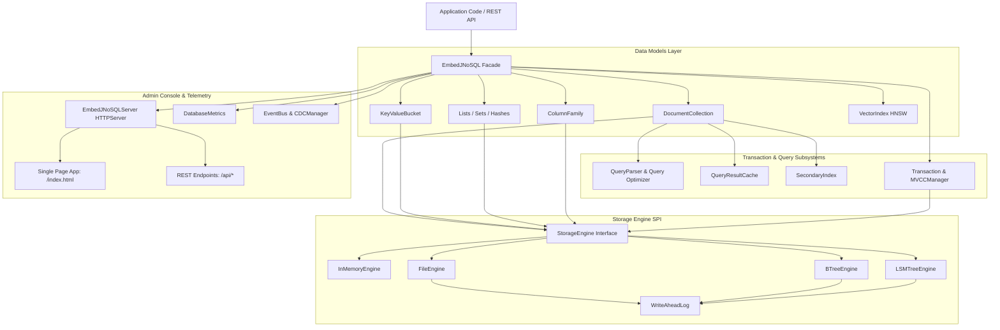

# EmbedJNoSQL System Architecture

## 1. High-Level Architectural Overview

EmbedJNoSQL is structured in clean concentric layers around a central storage engine Service Provider Interface (SPI). All higher-level models (Documents, Key-Value, Column Families) compile down to basic record and key-value primitives handled by the storage SPI.

---

## 2. Component Subsystems Breakdown

### A. Facade & Configuration (`org.embeddedjnosql.db`)
- **`EmbedJNoSQL`**: The primary lifecycle root and resource container. Implements `Closeable`. Owns the active `StorageEngine`, collection registries, buckets, metrics, event bus, and query cache.
- **`EmbedJNoSQLConfig`**: Immutable configuration bean built via fluent builder pattern (`embed().storageEngine(...).dataDir(...).build()`).
- **Lifecycle Guarantees**: Clean `close()` cascades down to all collections, flushes the active storage engine, executes WAL checkpointing, shuts down scheduled thread pools, and stops the HTTP console.

### B. Document Model Subsystem (`org.embeddedjnosql.db.nosql.document`)
- **`Document`**: Dynamic schema document implementing `UnifiedRecord`. Manages a `Map<String, Object>` with nested dotted-path evaluation (`user.address.city`) across maps and lists.
- **`DocumentCollection`**: Collection container for documents. Manages persistence, query execution, secondary indexes, cache invalidation, and TTL expiration on read.
- **`Query` & `QueryParser`**: Evaluates criteria filters with query hints (`NO_INDEX`, `FORCE_INDEX`) and index point-lookup optimizations.
- **`AggregationPipeline`**: Implements aggregation stages: `$match`, `$project`, `$group`, `$sort`, `$skip`, `$limit`.

### C. Key-Value & Redis Data Structures (`org.embeddedjnosql.db.nosql.kv`)
- **`KeyValueBucket`**: Simple key-value store with string values, TTL support, batch `putAll`, and atomic `increment`.
- **`ListBucket`**: Double-ended list structure (`RPUSH`, `LPUSH`, `RPOP`, `LPOP`, `LRANGE`, `LLEN`).
- **`SetBucket`**: Unique member sets with union, intersection, difference, and random sampling (`SADD`, `SREM`, `SISMEMBER`, `SMEMBERS`).
- **`HashBucket`**: Field-value mapping per key (`HSET`, `HGET`, `HDEL`, `HGETALL`, `HKEYS`, `HINCRBY`).

### D. Storage Engine SPI (`org.embeddedjnosql.db.storage.spi`)
1. **`InMemoryEngine`**: High-performance volatile memory engine backed by `ConcurrentHashMap`.
2. **`FileEngine`**: Directory-based engine maintaining individual `<collection>.json` snapshot files with periodic async flushing and WAL replay.
3. **`BTreeEngine`**: Stream-based sorted index (`btree_index.dat`) storing ordered keys with binary length prefixes and WAL-assisted durability.
4. **`LSMTreeEngine`**: Log-Structured Merge-Tree featuring an in-memory memtable, sorted string tables (`.sst`), Bloom filters for zero-I/O negative lookups, and background compaction.
5. **`WriteAheadLog`**: Append-only log recording all mutations prior to in-memory modification. Provides crash recovery via segment replay and rotation.

### E. Concurrency & Transactions (`org.embeddedjnosql.db.transaction.mvcc`)
- **`MVCCManager`**: Multi-Version Concurrency Control providing snapshot isolation. Uses monotonic atomic timestamps (`assignTimestamp()`), lock-free version chains (`VersionNode`), and optimistic first-committer-wins write-write conflict detection.
- **`Transaction`**: Transaction context tracking staged operations (`PUT`, `DELETE`). Executes commit with rollback undo logging on mutation errors.

### F. Administration Web Console (`org.embeddedjnosql.db.console.http`)
- Built using Java's built-in `com.sun.net.httpserver.HttpServer`.
- Zero external servlet container or web framework dependencies (maintaining small footprint).
- Full REST API under `/api/*` for documents, KV, metrics, health, transactions, backup, and CDC.
- Secure by default: Token sessions, CSRF headers, rate limiting, IP brute-force lockout, and Content Security Policy without `'unsafe-inline'` scripts.

---

## 3. Dependency Boundaries and Coupling Analysis

EmbedJNoSQL enforces strict dependency isolation:
1. **Mandatory Runtime Dependencies**:
   - `jackson-databind` (2.17.0) & `jackson-datatype-jsr310` (JSON serialization)
   - `slf4j-api` (2.0.12) (logging facade)
2. **Optional / Provided Dependencies**:
   - `jakarta.enterprise.cdi-api` (4.0.1) - Optional, only for CDI containers.
   - `jnosql-mapping-api-core` (1.1.8) - Optional, detected via reflection.
   - `jakarta.persistence-api` (3.1.0) - Optional, for JPA annotation mapping.
   - `hibernate-core` (6.4.4.Final) - Optional, for Hibernate annotation mapping.
3. **Excluded Dependencies**:
   - `net.bytebuddy` excluded from Jackson to reduce footprint by ~4 MB.
   - `slf4j-simple` excluded from the shaded JAR to avoid logger backend conflicts with Spring Boot, Quarkus, and Micronaut.
